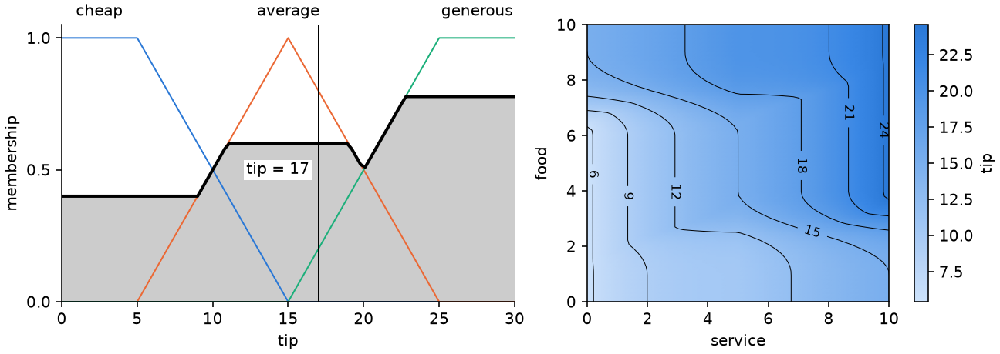

# fuzlog

Fuzzy logic for Python: membership functions, linguistic variables, Mamdani and
Sugeno inference. Built on NumPy, typed, Python 3.12+.

```sh
pip install fuzlog            # NumPy is the only dependency
pip install "fuzlog[plot]"    # adds matplotlib for the plots
```

## Example

How much to tip, given the service and the food:

```python
import fuzlog as fz

service = fz.partition("service", (0, 10), ["poor", "good", "excellent"])
food = fz.Variable("food", (0, 10), rancid=fz.z_shape(1, 4), tasty=fz.s_shape(6, 9))
tip = fz.partition("tip", (0, 30), cheap=5, average=15, generous=25)

tipper = fz.Mamdani(
    service.poor | food.rancid >> tip.cheap,
    service.good >> tip.average,
    service.excellent | food.tasty >> tip.generous,
)
print(round(tipper(service=3, food=8), 2))  # 17.03
print(tipper(service=[1, 5, 9], food=[2, 5, 8]).round(2).tolist())  # [8.2, 15.0, 21.8]
print(*tipper.rules, sep="\n")
# if service is poor or food is rancid then tip is cheap
# if service is good then tip is average
# if service is excellent or food is tasty then tip is generous
```

`tipper.plot(service=3, food=8)` and `tipper.surface("service", "food")` draw:



## What is inside

- **Sets.** 16 shapes: `triangle`, `trapezoid`, `rising`, `falling`, `rectangle`,
  `singleton`, `piecewise`, `gauss`, `gauss2`, `bell`, `sigmoid`, `dsigmoid`,
  `psigmoid`, `s_shape`, `z_shape`, `pi_shape`; any function of your own through
  `MF`. Sets combine with `&`, `|`, `~` and `**`.
- **Variables.** `Variable` names the terms of a quantity; `partition` builds terms
  that always sum to 1, also on periodic universes such as angles.
- **Rules.** `temp.hot & ~humid.dry >> fan.fast`, with weights and the hedges
  `very`, `extremely`, `somewhat`.
- **Inference.** `Mamdani` with any t-norm, s-norm, implication and aggregation and
  the defuzzifiers `centroid`, `bisector`, `mom`, `som`, `lom`; `Sugeno` with
  constant or functional conclusions.
- **Arrays.** A scalar gives a float, arrays give arrays, and inputs broadcast
  against each other.
- **Tables.** `compile` turns a system into a lookup table, also over transformed
  inputs, and a list of variables into a table of names such as `hot_wet`;
  `table.save(path)` and `load(path)` keep it on disk.
- **Plots.** `variable.plot()`, `system.plot(...)`, `system.surface(x, y)`.

## Documentation

- [Guide](https://github.com/coredegon/fuzlog/blob/main/docs/guide.md): the library from sets to inference
- [Membership functions](https://github.com/coredegon/fuzlog/blob/main/docs/shapes.md): every shape, its definition and its name elsewhere
- [Reference](https://github.com/coredegon/fuzlog/blob/main/docs/reference.md): every public name on one page

## Development

```sh
uv sync                 # environment with the dev tools
uv run pytest           # tests, including every example in the documentation
uv run ruff check       # lint; `uv run ruff format` formats
uv run ty check         # types
```

MIT license.
