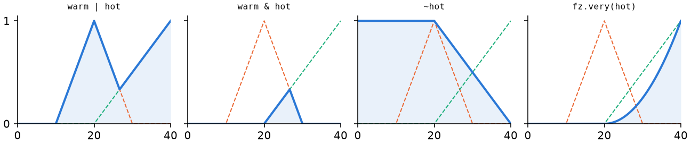
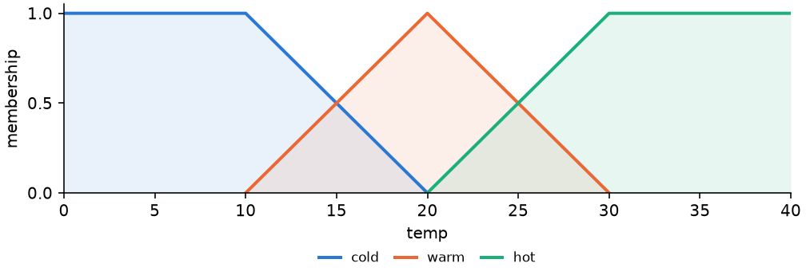
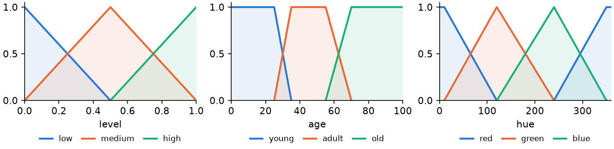
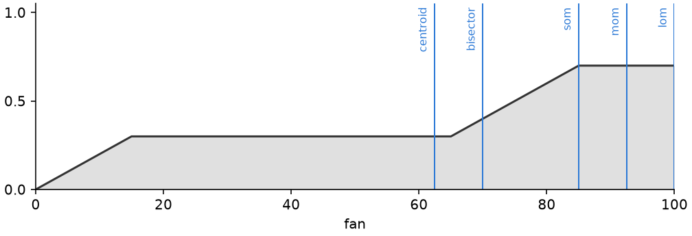
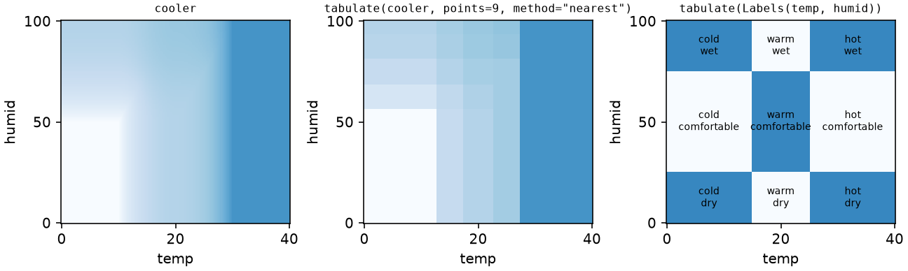

# Guide

[Sets](#sets) · [Variables](#variables) · [Rules](#rules) · [Mamdani](#mamdani) ·
[Sugeno](#sugeno) · [Labels](#labels) · [Tables](#tables) · [Plots](#plots) ·
[Math](#math)

```python
import numpy as np
import fuzlog as fz
```

## Sets

A set gives every value a degree from 0 to 1.

```python
warm = fz.triangle(10, 20, 30)
hot = fz.rising(20, 40)
print(warm(15))  # 0.5
print(warm([5, 15, 20, 27.5]).tolist())  # [0.0, 0.5, 1.0, 0.25]
```

| Expression | Degree |
|---|---|
| `a \| b`, `a & b` | maximum, minimum |
| `~a` | `1 - a` |
| `a ** p` | `a` to the power `p` |
| `fz.very(a)`, `fz.extremely(a)`, `fz.somewhat(a)` | `a ** 2`, `a ** 3`, `a ** 0.5` |



```python
print((warm | hot)(25), (warm & hot)(25), (~hot)(25), fz.very(hot)(30))
# 0.5 0.25 0.75 0.25
print(warm | hot)  # (triangle(10, 20, 30) | rising(20, 40))
```

There are [sixteen shapes](shapes.md), and any function of an array makes a set:

```python
spike = fz.Set(lambda x: np.exp(-np.abs(x - 20)), "spike")
print(spike(20))  # 1.0
```

## Variables

A variable is a quantity, its range and the terms that describe it.

```python
temp = fz.Variable(
    "temp",
    (0, 40),
    cold=fz.falling(10, 20),
    warm=fz.triangle(10, 20, 30),
    hot=fz.rising(20, 30),
)
print(temp(17.5).tolist())  # [0.25, 0.75, 0.0]
cold, warm, hot = temp([5.0, 17.5, 30.0])  # one row per term
print(warm.tolist())  # [0.0, 0.75, 0.0]
```



`partition` builds terms that always sum to 1 from their cores, the values that
belong to a term completely.

```python
level = fz.partition("level", (0, 1), ["low", "medium", "high"])
age = fz.partition("age", (0, 100), young=(0, 25), adult=(35, 55), old=(70, 100))
hue = fz.partition("hue", (0, 360), red=(350, 10), green=120, blue=240, periodic=True)
print(age)
# Variable('age', (0, 100), {'young': falling(25, 35), 'adult': trapezoid(25, 35, 55, 70), 'old': rising(55, 70)})
print(hue(355).tolist(), hue(-5).tolist())  # [1.0, 0.0, 0.0] [1.0, 0.0, 0.0]
```



| Argument | Meaning |
|---|---|
| a list of names | cores spread evenly over the universe |
| `name=value` | a core at one value |
| `name=(low, high)` | a core over a range |
| `periodic=True` | the universe is a circle: the last term blends into the first |

Names that are not Python identifiers go in a mapping:
`fz.Variable("light", (0, 1), {"very dim": fz.falling(0.1, 0.3)})`.

## Rules

`temp.hot`, or `temp["hot"]`, is the proposition "temp is hot". Propositions
combine like sets, and `>>` makes a rule.

```python
humid = fz.partition("humid", (0, 100), ["dry", "comfortable", "wet"])
fan = fz.partition("fan", (0, 100), ["slow", "medium", "fast"])

muggy = temp.hot & humid.wet
print(muggy)  # temp is hot and humid is wet
print(muggy(temp=28, humid=90))  # 0.8
print(muggy(temp=[22, 28, 35], humid=90).tolist())  # [0.2, 0.8, 0.8]

print(temp.hot & humid.wet >> fan.fast)
# if temp is hot and humid is wet then fan is fast
print(fz.Rule(temp.cold, fan.slow, weight=0.5))
# if temp is cold then fan is slow [0.5]
```

`>>` takes everything to its left as the condition, so it needs no brackets.
Python's `and`, `or` and `not` cannot be redefined: on sets and propositions they
raise a `TypeError`.

## Mamdani

Every rule concludes "output is term" about one variable.

```python
cooler = fz.Mamdani(
    temp.cold >> fan.slow,
    temp.warm >> fan.medium,
    temp.hot | humid.wet >> fan.fast,
)
print(cooler)  # Mamdani(3 rules: temp, humid -> fan)
print(round(cooler(temp=27, humid=40), 2))  # 62.44

# inputs broadcast: a column of temperatures and a row of humidities
print(cooler(temp=[[15], [27]], humid=[20, 60, 100]).round(2).tolist())
# [[44.05, 45.22, 54.63], [62.44, 62.44, 64.27]]

# where no rule fires
print(fz.Mamdani(temp.cold >> fan.slow)(temp=30))  # nan
```


Each step can be replaced:

| Argument | Default | Step |
|---|---|---|
| `tnorm` | `np.minimum` | how `&` combines degrees |
| `snorm` | `np.maximum` | how `\|` combines degrees |
| `implication` | `np.minimum` | how a firing strength shapes the concluded set |
| `aggregation` | `np.maximum` | how the shaped sets merge |
| `defuzz` | `fz.centroid` | how the merged set becomes a number |
| `points` | `101` | size of the grid `cooler.x` the output is sampled on |

A norm is any function of two arrays of degrees:

| | t-norm | s-norm |
|---|---|---|
| Zadeh | `np.minimum` | `np.maximum` |
| probabilistic | `np.multiply` | `fz.probor` |
| Łukasiewicz | `fz.bounded_diff` | `fz.bounded_sum` |

```python
larsen = fz.Mamdani(
    *cooler.rules, tnorm=np.multiply, snorm=fz.probor, implication=np.multiply
)
print(round(larsen(temp=27, humid=40), 2))  # 67.23

# the merged set itself, sampled on cooler.x
print(cooler.aggregate(temp=27, humid=40).shape)  # (101,)
```

A defuzzifier is a function `(x, mu)` of a grid and the degrees on it:



```python
for defuzz in (fz.centroid, fz.bisector, fz.som, fz.mom, fz.lom):
    system = fz.Mamdani(*cooler.rules, defuzz=defuzz)
    print(defuzz.__name__, round(system(temp=27, humid=40), 2))
# centroid 62.44
# bisector 70.0
# som 85.0
# mom 92.5
# lom 100.0
```

## Sugeno

A rule concludes a number, or a function of the inputs it names. The output is
the average of the conclusions, weighted by how strongly their rules fire.

```python
heater = fz.Sugeno(
    temp.cold >> 10,
    temp.warm >> 50,
    temp.hot >> (lambda temp: 60 + temp),
)
print(heater(temp=17.5))  # 40.0
print(heater(temp=[5, 17.5, 28]).tolist())  # [10.0, 40.0, 80.4]
```

## Labels

`Labels` names the strongest term of every variable.

```python
words = fz.Labels(temp, humid)
print(words(temp=27, humid=40))  # hot_comfortable
print(words(temp=[5, 18, 33], humid=90).tolist())  # ['cold_wet', 'warm_wet', 'hot_wet']
print(fz.Labels(humid, temp, sep=" and ")(temp=27, humid=40))  # comfortable and hot
```

Of equal terms the first wins. The label is empty where an input is NaN or
belongs to no term.

## Tables

`tabulate` evaluates a system on a grid once; the `Table` then answers by lookup,
however many rules there were.

```python
table = fz.tabulate(cooler, points=201)
print(table)
# Table(temp[201] x humid[201], linear, from Mamdani(3 rules: temp, humid -> fan))
print(round(cooler(temp=27.3, humid=41), 2), round(table(temp=27.3, humid=41), 2))
# 63.74 63.75

table.save("cooler.npz")  # numbers and axes: loading needs no rules
table = fz.Table.load("cooler.npz")
print(round(table(temp=27.3, humid=41), 2))  # 63.75
```



| Argument | Meaning |
|---|---|
| `axes` | `{name: points}`, `{name: (low, high)}` or `{name: (low, high, points)}`; by default every input of the system |
| `points` | points of every axis that gives none: `101` |
| `method` | `"linear"` interpolates between nodes, `"nearest"` takes the closest one |
| `dtype` | `np.float32` halves the size; a whole type such as `np.uint8` with `"nearest"` is also the type of the answers |

Anything called with keyword arrays can be tabulated, so a function puts a system
on other axes:

```python
def imperial(fahrenheit, moisture):
    return cooler(temp=(fahrenheit - 32) / 1.8, humid=100 * moisture)


table = fz.tabulate(imperial, {"fahrenheit": (32, 104, 289), "moisture": (0, 1, 201)})
print(round(table(fahrenheit=81.14, moisture=0.41), 2))  # 63.75
```

What answers with strings gives a table of labels: the distinct strings in
`table.labels` and a small whole number per node.

```python
named = fz.tabulate(words)
print(named)  # Table(temp[101] x humid[101], 9 labels, from Labels(temp, humid))
print(named(temp=27, humid=40))  # hot_comfortable
code = named.codes(temp=27, humid=40)  # the position instead of the string
print(named.labels[code])  # hot_comfortable
```

## Plots

```python
import matplotlib.pyplot as plt

fz.plot(temp)  # the terms of a variable
fz.plot(cooler, temp=27, humid=40)  # the inferred output set and its crisp value
fz.surface(cooler, "temp", "humid")  # the output over two inputs

fig, ax = plt.subplots()
fz.surface(cooler, "temp", "humid", ax)  # on an Axes of your own
plt.show()
```

Every call returns the Axes and follows the active matplotlib style.

## Math

`fuzlog.math` holds the mathematics as plain NumPy functions that know nothing
about sets, variables or rules.

| Module | Holds |
|---|---|
| `curves` | the sixteen shapes: `curves.triangle(2, 5, 8)` is a function of an array |
| `norms` | `probor`, `bounded_sum`, `bounded_diff` |
| `defuzz` | `centroid`, `bisector`, `mom`, `som`, `lom` |
| `grid` | `locate`, `nearest`, `linear`: lookup in values on an even grid |

```python
from fuzlog.math import curves, defuzz, norms

x = np.linspace(0, 10, 101)
mu = norms.probor(curves.triangle(2, 4, 9)(x), curves.gauss(8, 1)(x))
print(round(float(defuzz.centroid(x, mu)), 2))  # 6.11
```
