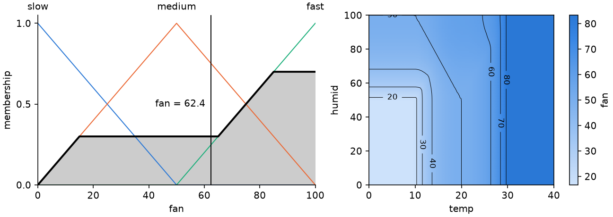

# Guide

```pycon
>>> import numpy as np
>>> import fuzlog as fz
```

## Sets

A fuzzy set maps a value to its degree of membership, from 0 to 1. A set is built
from a [shape](shapes.md) and called like a function: a scalar gives a float, an
array gives an array of the same shape.

```pycon
>>> warm = fz.triangle(10, 20, 30)
>>> warm(15)
0.5
>>> warm([5, 15, 20, 27.5]).tolist()
[0.0, 0.5, 1.0, 0.25]
```

Sets combine pointwise: `&` is the minimum, `|` the maximum, `~` the complement and
`**` a power. The hedges `very`, `extremely` and `somewhat` are the powers 2, 3
and 0.5.

```pycon
>>> hot = fz.rising(20, 40)
>>> (warm | hot)(25), (warm & hot)(25), (~hot)(25), fz.very(hot)(30)
(0.5, 0.25, 0.75, 0.25)
>>> warm | hot
(triangle(10, 20, 30) | rising(20, 40))
```

Any function of an array makes a set. It receives a float64 array and returns the
degrees:

```pycon
>>> spike = fz.MF(lambda x: np.exp(-np.abs(x - 20)), "spike")
>>> spike(20)
1.0
```

## Variables

A linguistic variable is a quantity, the range of its values and the terms that
describe them.

```pycon
>>> temp = fz.Variable(
...     "temp",
...     (0, 40),
...     cold=fz.falling(10, 20),
...     warm=fz.triangle(10, 20, 30),
...     hot=fz.rising(20, 30),
... )
>>> temp.fuzzify(17.5)
{'cold': 0.25, 'warm': 0.75, 'hot': 0.0}
```

Calling the variable gives the degrees as one array with a row per term, which
unpacks into the terms:

```pycon
>>> cold, warm, hot = temp([5.0, 17.5, 30.0])
>>> warm.tolist()
[0.0, 0.75, 0.0]
```

Term names that are not Python identifiers go in a mapping:
`fz.Variable("light", (0, 1), {"very dim": fz.falling(0.1, 0.3)})`.


### Partitions

`partition` builds the terms from their cores, the values that belong to a term
completely. Between neighbouring cores membership passes linearly from one term to
the next, so the degrees always sum to 1.

```pycon
>>> fz.partition("temp", (0, 40), cold=10, warm=20, hot=30)
Variable('temp', (0, 40), {'cold': falling(10, 20), 'warm': triangle(10, 20, 30), 'hot': rising(20, 30)})
>>> fz.partition("age", (0, 100), young=(0, 25), adult=(35, 55), old=(70, 100))
Variable('age', (0, 100), {'young': falling(25, 35), 'adult': trapezoid(25, 35, 55, 70), 'old': rising(55, 70)})
>>> fz.partition("level", (0, 1), ["low", "medium", "high"])  # evenly spaced
Variable('level', (0, 1), {'low': falling(0, 0.5), 'medium': triangle(0, 0.5, 1), 'high': rising(0.5, 1)})
```

A `periodic` universe is a circle: the last term blends back into the first, a core
may wrap around, and values are wrapped into the universe before the terms see them.

```pycon
>>> wind = fz.partition("wind", (0, 360), ["north", "east", "south", "west"], periodic=True)
>>> wind.fuzzify(315)
{'north': 0.5, 'east': 0.0, 'south': 0.0, 'west': 0.5}
>>> wind.fuzzify(-45) == wind.fuzzify(315)
True
>>> hue = fz.partition("hue", (0, 360), red=(350, 10), green=120, blue=240, periodic=True)
>>> hue.fuzzify(355)
{'red': 1.0, 'green': 0.0, 'blue': 0.0}
```

`peaks` gives the most typical value of every term, the middle of its core:

```pycon
>>> temp.peaks().round(2).tolist()
[5.0, 20.0, 35.0]
```

## Propositions and rules

`temp.hot`, or `temp["hot"]` for any name, is the proposition "temp is hot".
Propositions combine with `&` (and), `|` (or), `~` (not) and the hedges, and calling
one tells to what degree it holds for the given inputs.

```pycon
>>> humid = fz.partition("humid", (0, 100), ["dry", "comfortable", "wet"])
>>> muggy = temp.hot & humid.wet
>>> muggy
temp is hot and humid is wet
>>> muggy(temp=28, humid=90)
0.8
>>> muggy(temp=[22, 28, 35], humid=90).tolist()
[0.2, 0.8, 0.8]
```

`>>` turns a proposition into a rule. Python binds `>>` tighter than `&` and `|`,
and fuzlog accounts for it, so the condition needs no brackets. `Rule` adds a weight
that scales how strongly the rule fires.

```pycon
>>> fan = fz.partition("fan", (0, 100), ["slow", "medium", "fast"])
>>> temp.hot & humid.wet >> fan.fast
if temp is hot and humid is wet then fan is fast
>>> fz.Rule(temp.cold, fan.slow, weight=0.5)
if temp is cold then fan is slow [0.5]
```

Python's own `and`, `or` and `not` cannot be redefined, so using them on
propositions or sets raises a `TypeError` instead of silently dropping a condition.

## Mamdani inference

Every rule concludes "output is term" about the same output variable. The system
fires the rules, shapes the concluded sets by the firing strengths, merges them and
reduces the result to one number.

```pycon
>>> cooler = fz.Mamdani(
...     temp.cold >> fan.slow,
...     temp.warm >> fan.medium,
...     temp.hot | humid.wet >> fan.fast,
... )
>>> cooler
Mamdani(3 rules: temp, humid -> fan)
>>> round(cooler(temp=27, humid=40), 2)
62.44
```

Inputs are named after the variables and broadcast against each other, so a column
of temperatures and a row of humidities give a table of fan speeds. Where no rule
fires the result is NaN.

```pycon
>>> cooler(temp=[[15], [27]], humid=[20, 60, 100]).round(2).tolist()
[[44.05, 45.22, 54.63], [62.44, 62.44, 64.27]]
>>> fz.Mamdani(temp.cold >> fan.slow)(temp=30)
nan
```

Each step can be replaced. A norm is any function of two arrays of degrees; NumPy's
`minimum`, `multiply` and `maximum` are norms already, and fuzlog adds `probor`,
`bounded_sum` and `bounded_diff`.

| Argument | Default | Meaning |
|---|---|---|
| `tnorm` | `np.minimum` | how `&` combines degrees |
| `snorm` | `np.maximum` | how `\|` combines degrees |
| `implication` | `np.minimum` | how a firing strength shapes the concluded set |
| `aggregation` | `np.maximum` | how the shaped sets merge |
| `defuzz` | `fz.centroid` | how the merged set becomes a number |
| `points` | `101` | size of the grid the output universe is sampled on |

```pycon
>>> larsen = fz.Mamdani(
...     *cooler.rules, tnorm=np.multiply, snorm=fz.probor, implication=np.multiply
... )
>>> round(larsen(temp=27, humid=40), 2)
67.23
```

`aggregate` returns the merged set itself, sampled on the grid `cooler.x`:

```pycon
>>> cooler.aggregate(temp=27, humid=40).shape
(101,)
```

### Defuzzification

A defuzzifier is a function `(x, mu)` of a grid and of degrees whose last axis runs
over that grid.

| Function | Result |
|---|---|
| `centroid` | centre of gravity of the area under the set |
| `bisector` | value that splits the area in two halves |
| `mom` | mean of the values where the set is highest |
| `som` | smallest value where the set is highest |
| `lom` | largest value where the set is highest |

```pycon
>>> for defuzz in (fz.centroid, fz.bisector, fz.mom, fz.som, fz.lom):
...     system = fz.Mamdani(*cooler.rules, defuzz=defuzz)
...     print(defuzz.__name__, round(system(temp=27, humid=40), 2))
centroid 62.44
bisector 70.0
mom 92.5
som 85.0
lom 100.0
```

`centroid` treats the set as straight lines between its samples, so it is exact
when the grid holds every corner of the set and close otherwise. The other four
answer with a grid value.

## Sugeno inference

A Sugeno rule concludes a number, or a function that is called with the inputs as
keyword arguments. The output is the average of the conclusions, weighted by the
firing strengths.

```pycon
>>> heater = fz.Sugeno(
...     temp.cold >> 10,
...     temp.warm >> 50,
...     temp.hot >> (lambda temp, **others: 60 + temp),
... )
>>> heater(temp=17.5)
40.0
>>> heater(temp=[5, 17.5, 28]).tolist()
[10.0, 40.0, 80.4]
```

## Plots

Plots need matplotlib: `pip install "fuzlog[plot]"`. Each call draws on the Axes it is
given, or on a new figure, and returns the Axes, so it works the same in a script
and in a notebook.

```python
temp.plot()  # the terms of a variable
cooler.plot(temp=27, humid=40)  # the inferred output set and its crisp value
cooler.surface("temp", "humid")  # the output over two inputs
cooler.surface("temp", "humid", ax)  # on an Axes of your own
```



Plots follow the active matplotlib style. Terms are coloured from a palette of
eight colour-blind-safe hues; a variable with more terms is drawn in one hue, with
the term names above the peaks.
