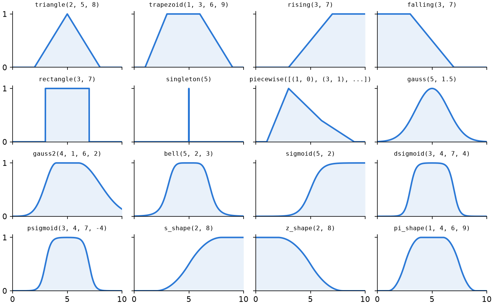

# Membership functions

Sixteen shapes cover the thirteen built into the MATLAB Fuzzy Logic Toolbox and the
shapes of IEEE 1855 (Fuzzy Markup Language). Each call returns a set, an `MF`.



## Piecewise-linear

Breakpoints are given in ascending order. Equal neighbours make a vertical edge, at
which the set takes the larger value: `trapezoid(0, 0, 2, 4)` is 1 at 0.

| fuzlog | Definition | MATLAB | IEEE 1855 |
|---|---|---|---|
| `triangle(a, b, c)` | rises from `a` to its peak at `b`, falls to `c` | `trimf` | TriangularShape |
| `trapezoid(a, b, c, d)` | rises from `a` to `b`, is 1 until `c`, falls to `d` | `trapmf` | TrapezoidShape |
| `rising(a, b)` | 0 up to `a`, then linear, 1 from `b` on | `linsmf` | RightLinearShape |
| `falling(a, b)` | 1 up to `a`, then linear, 0 from `b` on | `linzmf` | LeftLinearShape |
| `rectangle(a, b)` | 1 on `[a, b]`, 0 elsewhere | | RectangularShape |
| `singleton(a)` | 1 at `a`, 0 elsewhere | | SingletonShape |
| `piecewise(points)` | straight lines through `(x, degree)` points, flat outside them | | UserShape |

## Smooth

Shapes with a centre take it first, then what sets their width.

| fuzlog | Definition | MATLAB | IEEE 1855 |
|---|---|---|---|
| `gauss(c, sigma)` | `exp(-(x - c)ВІ / (2 sigmaВІ))` | `gaussmf` | GaussianShape |
| `gauss2(c1, sigma1, c2, sigma2)` | `gauss(c1, sigma1)` left of `c1`, 1 between, `gauss(c2, sigma2)` right of `c2` | `gauss2mf` | |
| `bell(c, width, slope)` | `1 / (1 + \|(x - c) / width\|^(2 slope))` | `gbellmf` | |
| `sigmoid(c, slope)` | `1 / (1 + exp(-slope (x - c)))` | `sigmf` | |
| `dsigmoid(c1, slope1, c2, slope2)` | `\|sigmoid(c1, slope1) - sigmoid(c2, slope2)\|` | `dsigmf` | |
| `psigmoid(c1, slope1, c2, slope2)` | `sigmoid(c1, slope1) В· sigmoid(c2, slope2)` | `psigmf` | |
| `s_shape(a, b)` | spline from 0 at `a` to 1 at `b`: `2tВІ` up to the middle, `1 - 2(1 - t)ВІ` after it, with `t = (x - a) / (b - a)` | `smf` | SShape |
| `z_shape(a, b)` | `1 - s_shape(a, b)` | `zmf` | ZShape |
| `pi_shape(a, b, c, d)` | `s_shape(a, b) В· z_shape(c, d)` | `pimf` | PIShape |

Coming from MATLAB, mind the order of the parameters: `gaussmf(x, [sigma c])` is
`gauss(c, sigma)`, `sigmf(x, [a c])` is `sigmoid(c, a)`, `gbellmf(x, [a b c])` is
`bell(c, a, b)`, and `gauss2mf`, `dsigmf` and `psigmf` change the same way.

## Anything else

A shape that is not listed is one line away. The half-Gaussian shoulders of
IEEE 1855 are a Gaussian joined to a step:

```pycon
>>> import numpy as np
>>> import fuzlog as fz

>>> shoulder = fz.gauss(5, 1) | fz.rising(5, 5)
>>> shoulder([4.0, 5.0, 9.0]).round(3).tolist()
[0.607, 1.0, 1.0]
```

and any function of an array is a set:

```pycon
>>> cosine = fz.MF(lambda x: np.cos(np.clip(x - 5, -2, 2) * np.pi / 4) ** 2, "cosine")
>>> cosine([3.0, 4.0, 5.0]).round(3).tolist()
[0.0, 0.5, 1.0]
```
